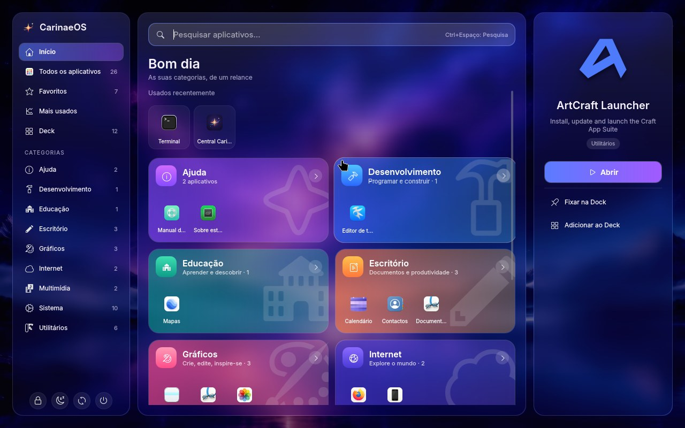
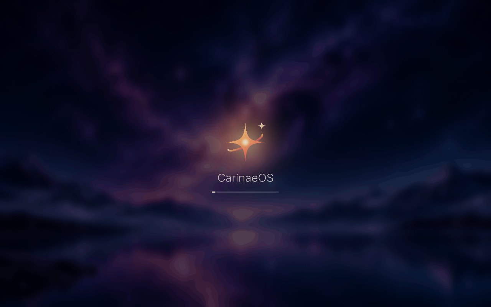
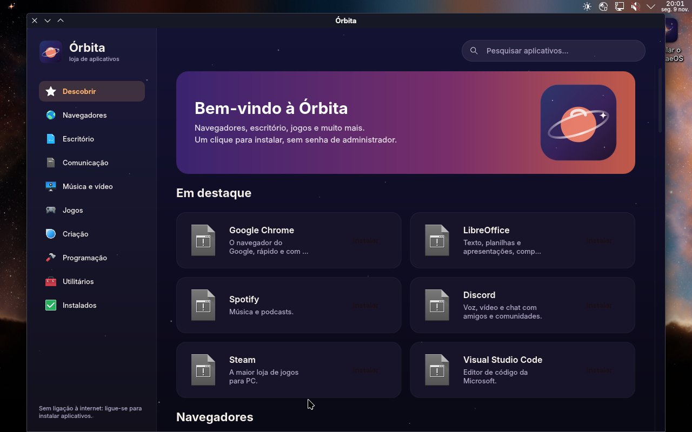
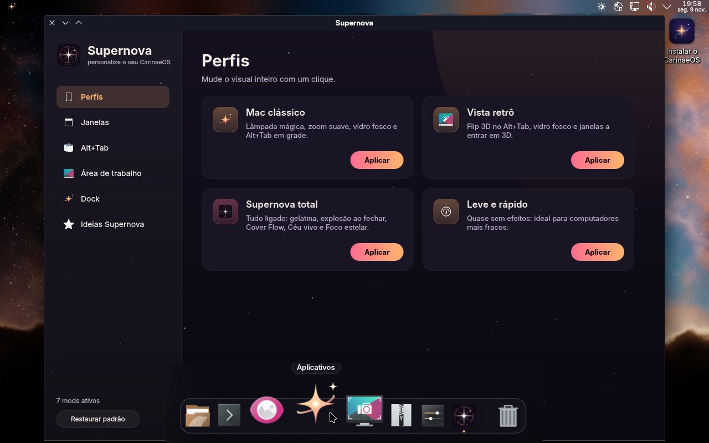
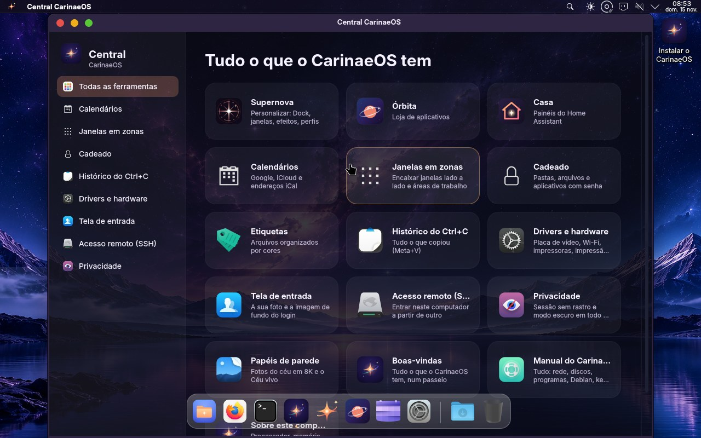
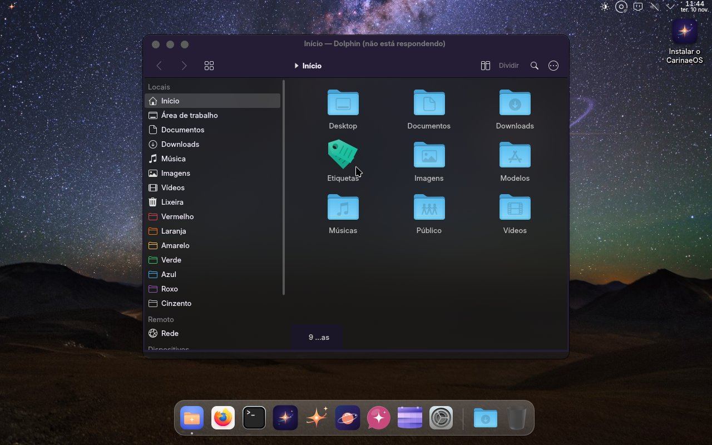

<p align="center">
  
</p>

<p align="center">
  <a href="../../releases"><b>⬇ Baixar a ISO</b></a> ·
  <a href="#-experimentar-em-5-minutos">Experimentar</a> ·
  <a href="#-launchpad-comando-e-deck">Launchpad, Comando e Deck</a> ·
  <a href="#-como-é-feito">Como é feito</a>
</p>

---

**CarinaeOS** é um sistema operacional para computadores, feito para quem quer um Linux
**bonito e fácil desde o primeiro minuto**, sem precisar abrir o terminal.
Ele junta a solidez do **Debian 13** com o **KDE Plasma 6** e dá-lhe uma cara nova: Dock com lupa,
barra no topo, um Launchpad em vidro fosco com categorias e Deck, a barra **Comando**
(<kbd>Ctrl</kbd>+<kbd>Espaço</kbd>), uma loja de aplicativos própria e um painel de efeitos.

O nome vem de **Eta Carinae**, uma das estrelas mais brilhantes e instáveis da nossa galáxia.
A estrela de quatro pontas é o símbolo do sistema; o papel de parede é uma nebulosa violeta
sobre um lago espelhado.

> **Estado:** versão de testes (*release candidate*). Já dá para usar e instalar, mas ainda pode
> ter arestas. Encontrou alguma coisa? Abra uma [*issue*](../../issues).

## ✨ Destaques

<table>
  <tr>
    <td width="50%"></td>
    <td width="50%"></td>
  </tr>
  <tr>
    <td><b>Área de trabalho</b>: o céu real do Atacama com a estrela do CarinaeOS, barra no topo e
        Dock de vidro que amplia os ícones, com <b>Downloads</b> e <b>Lixeira</b> no fim.</td>
    <td><b>Tela de entrada</b>: relógio grande, senha embaixo e o céu da Eta Carinae ao fundo.
        Aceita senhas simples, como um PIN de 4 a 6 números.</td>
  </tr>
  <tr>
    <td></td>
    <td></td>
  </tr>
  <tr>
    <td><b>Launchpad</b>: clique na estrela (ou aperte a tecla ⊞/⌘): categorias em cartões,
        favoritos, mais usados, o Deck e o detalhe de cada aplicativo, tudo em vidro fosco.</td>
    <td><b>Arranque com a estrela</b>: do menu de arranque à tela de carregamento e ao instalador,
        tudo com a marca CarinaeOS. Nenhum logotipo do Debian ou do KDE à vista.</td>
  </tr>
  <tr>
    <td></td>
    <td></td>
  </tr>
  <tr>
    <td><b>Órbita</b>: a loja de aplicativos. Chrome, LibreOffice, Spotify, Discord, VS Code, Steam…
        com um clique, sem senha e com o progresso do download.</td>
    <td><b>Supernova</b>: o painel de personalização. Efeitos de janela (lâmpada mágica,
        gelatina, explosão), Alt+Tab em Flip 3D ou em grade, ajustes da Dock e perfis prontos.</td>
  </tr>
  <tr>
    <td></td>
    <td></td>
  </tr>
  <tr>
    <td><b>Central CarinaeOS</b>: todas as ferramentas do sistema num só lugar.</td>
    <td><b>Arquivos</b> no visual Vidro, com as etiquetas coloridas na barra lateral.</td>
  </tr>
</table>

E ainda:

- **Visual Vidro**: janelas translúcidas com desfoque, botões redondos, ícones coloridos e
  papéis de parede com **fotografias reais do céu do Atacama** (ESO) com a estrela do CarinaeOS a brilhar,
  do arranque animado e da tela de entrada até à área de trabalho.
- **Central CarinaeOS**: todas as ferramentas num só lugar — Supernova, Órbita, Casa, Ambiente,
  Calendários, Janelas em zonas, Cadeado, Etiquetas, Histórico do Ctrl+C, Drivers, Acesso remoto (SSH) e Privacidade.
- **Janelas em zonas**: esquemas prontos (2 ou 3 colunas, grade, principal + duas); arraste com Shift para encaixar.
  E **áreas de trabalho** como os Spaces do Mac (<kbd>Ctrl</kbd>+<kbd>⊞</kbd>+<kbd>←/→</kbd>, <kbd>⊞</kbd>+<kbd>W</kbd>).
- **Histórico do Ctrl+C** com <kbd>⊞</kbd>+<kbd>V</kbd>.
- **Drivers e hardware**: deteta placa NVIDIA, Wi-Fi, Bluetooth, impressoras e scanners, leitor de impressão digital,
  ratos Logitech e de jogos, e instala o que falta com um clique.
- **Sessão sem rastro**: “Convidado” na tela de entrada; tudo vive na memória e desaparece ao sair.
- **Modo escuro em todo o lado**, até no Chrome, no Firefox e nos aplicativos GTK e Flatpak.
- **Janelas de senha com a marca CarinaeOS** sempre que o sistema pede permissão.
- **Estilo Mac ou estilo Windows 11**: barra em cima e Dock em baixo, ou barra de tarefas ao centro com a estrela no menu Iniciar. E também **GNOME** e **XFCE**, instalados com um clique e sempre com a Dock visível, o tema e os papéis de parede do CarinaeOS.
- **Casa**: painéis do Home Assistant que monta como quiser (leves, sem travar, mesmo com centenas de aparelhos), com 13 tipos de cartões (botão, luz, lista, sensor,
  gráfico de 24 h, clima, cenas, som e TV, câmara, estores, tempo, número, texto), e este PC como dispositivo no Home Assistant.
- **Calendários**: conta Google, iCloud (CalDAV) ou qualquer endereço iCal (Google, iCloud, Outlook, feriados), e **Mapas**.
- **Etiquetas** coloridas nos Arquivos, como no Finder, na barra lateral (GNOME e XFCE também), até em pastas de rede.
- **Papéis de parede em 8K**: o céu do Atacama com a estrela, fotografias do James Webb e do Hubble e desenhos originais.
- **ArtCraft Launcher** já instalado, para baixar os aplicativos da Craft App Suite.
- **AppImage com duplo clique** (por exemplo o Elegoo Slicer para impressoras 3D): o CarinaeOS instala-o no menu,
  com ícone, e oferece pô-lo na Dock.
- **Tela de entrada à sua maneira**: a sua foto e a imagem de fundo do login (Central › Tela de entrada).
- **Todas as janelas com os botões do Mac à esquerda**, com as mesmas cores, também nos aplicativos GTK e nos
  navegadores (Chrome, Chromium, Firefox).
- **Barra de cima em todos os estilos** (Mac, Windows 11, GNOME e XFCE), com o nome do aplicativo em negrito e o seu menu.
- **NumLock ligado** ao entrar, para escrever a senha logo.
- **Boas-vindas** depois de instalar, a mostrar tudo o que o sistema tem.

- **Acesso remoto por SSH** com um interruptor (Central › Acesso remoto), com o comando certo para entrar a partir de outro computador.
- **Cadeado em pastas, arquivos e aplicativos**: botão direito → *Trancar com senha*. A pasta fica no mesmo
  sítio com um cadeado e só abre com a senha (cifrada com AES-256). Funciona no Plasma, no GNOME e no XFCE.
- **Céu vivo** (liga-se no Supernova): o fundo de tela muda de tom ao longo do dia — madrugada, manhã, tarde e noite.
- **Alt+Tab em Flip 3D**, como no Windows Vista, ou em grade, como no Mac.
- **Tudo em português**, do arranque ao instalador.

## ✦ Launchpad, Comando e Deck

**Launchpad** (estrela da Dock ou tecla <kbd>⊞</kbd>): o ecrã inteiro em vidro fosco sobre o papel de parede.
À esquerda, as vistas — *Início*, *Todos os aplicativos*, *Favoritos* (os da Dock), *Mais usados* e *Deck* — e as
categorias com o número de aplicativos. No *Início*, cada categoria é um cartão colorido com os seus aplicativos
(Internet, Gráficos, Multimédia, Jogos, Sistema…). À direita, o detalhe do aplicativo por baixo do rato:
descrição, **Abrir**, as **ações rápidas** (Nova janela, Nova janela privada…), *Fixar na Dock* e *Adicionar ao Deck*.
Escreva para pesquisar; setas e Enter também funcionam.

**Deck**: uma grelha de botões grandes, como um Stream Deck, para o que faz todos os dias — captura de ecrã,
terminal, transferências, monitor do sistema, todas as janelas, bloquear… Junte aplicativos (botão direito ›
*Adicionar ao Deck*), comandos ou sites; tire com o botão direito.

**Comando** (<kbd>Ctrl</kbd>+<kbd>Espaço</kbd>), inspirado no Raycast: uma barra ao centro do ecrã que mostra
logo a **CPU, a memória, o disco livre e os programas que mais gastam**, e encontra aplicativos, comandos do
sistema (bloquear, Wi-Fi, som, ecrãs, SSH…), **arquivos**, o **histórico da área de transferência**, faz **contas**
(`2*3,5`), abre sites e pesquisa na web. Comece com `>` para correr um comando no terminal.
<kbd>Ctrl</kbd>+<kbd>1…9</kbd> abre o resultado, <kbd>Ctrl</kbd>+<kbd>K</kbd> mostra as ações (mostrar na pasta,
copiar o caminho, adicionar à Dock…).

## 📖 Manual

O **[Manual do CarinaeOS](docs/manual/00-indice.md)** explica tudo: a área de trabalho, as ferramentas,
arquivos e discos, **HD na rede e pastas partilhadas** (SMB/NAS, NFS, SSH), programas (apt, Flatpak, AppImage),
hardware e drivers, o Debian, o kernel Linux e uma referência grande de **comandos do terminal**.
Vem dentro do sistema como o aplicativo *Manual*, com pesquisa.

## ⌨️ Atalhos úteis

| Atalho | O que faz |
|---|---|
| <kbd>⊞</kbd> (tecla Windows / ⌘) | Abre o Launchpad |
| <kbd>Ctrl</kbd>+<kbd>Espaço</kbd> (ou <kbd>⊞</kbd>+<kbd>Espaço</kbd>) | Comando: aplicativos, arquivos, contas, área de transferência |
| <kbd>Alt</kbd>+<kbd>F2</kbd> | KRunner (a pesquisa do KDE) |
| <kbd>Alt</kbd>+<kbd>Tab</kbd> | Troca de janela em Flip 3D |
| <kbd>⊞</kbd>+<kbd>V</kbd> | Histórico do Ctrl+C |
| <kbd>⊞</kbd>+<kbd>W</kbd> | Todas as janelas e áreas de trabalho |
| <kbd>⊞</kbd>+<kbd>T</kbd> | Desenhar as zonas das janelas (arraste com Shift para encaixar) |
| <kbd>Print</kbd> | Captura de tela |

## 🚀 Experimentar em 5 minutos

1. Em [**Releases**](../../releases), abra a versão mais recente e baixe **todas as partes**
   (`CarinaeOS-1.0-amd64.iso.parte00`, `parte01`, …) e o arquivo `.sha256` para a mesma pasta.
   A ISO vem em partes porque o GitHub não aceita arquivos com mais de 2 GB.
2. Junte as partes numa única ISO:

   - **Windows**: abra a pasta, clique na barra de endereço, escreva `cmd` e Enter. Depois:
     ```
     copy /b CarinaeOS-1.0-amd64.iso.parte00 + CarinaeOS-1.0-amd64.iso.parte01 CarinaeOS-1.0.iso
     ```
     No **PowerShell**, ponha `cmd /c` antes do mesmo comando.
   - **macOS / Linux**:
     ```
     cat CarinaeOS-1.0-amd64.iso.parte* > CarinaeOS-1.0.iso
     ```

   Opcional, para confirmar que veio inteira: `certutil -hashfile CarinaeOS-1.0.iso SHA256`
   (Windows) ou `shasum -a 256 CarinaeOS-1.0.iso` (Mac/Linux). O código tem de ser igual ao do `.sha256`.

3. **Numa máquina virtual** (VirtualBox, VMware, GNOME Boxes…): crie uma máquina
   *Linux → Debian 64-bit* com **4 GB de memória**, **2 processadores**, **30 GB de disco**, vídeo
   **VMSVGA com 128 MB** e aceleração 3D. Use a ISO como disco de arranque.
   No VirtualBox, marque *“Pular instalação desassistida”*.

   **Num computador de verdade**: grave a ISO num pen drive de 4 GB ou mais com o
   [balenaEtcher](https://etcher.balena.io/) ou o [Rufus](https://rufus.ie/) (modo *DD*) e arranque por ele.

4. Na tela de entrada: usuário **CarinaeOS**, senha **`live`**.
5. Gostou? Clique duas vezes em **Instalar o CarinaeOS**, na área de trabalho.
   O instalador é guiado e aceita senhas simples.

> **Dica:** na sessão de teste (sem instalar), tudo o que instala ou muda fica na memória e
> desaparece quando desliga. Para guardar, instale o CarinaeOS no disco.

**Requisitos:** processador de 64 bits (x86-64), 4 GB de memória e 30 GB de disco. Funciona com e sem UEFI.

## 🛠 Como é feito

O CarinaeOS é montado com o [live-build](https://live-team.pages.debian.net/live-manual/) do
Debian. A ISO é gerada automaticamente pelo **GitHub Actions** sempre que o arquivo
[`carinae-debian/VERSAO`](carinae-debian/VERSAO) muda, e é publicada em *Releases*.

```
carinae-debian/              a receita da ISO
├── construir.sh             monta tudo e chama o live-build
├── VERSAO                   mudar este arquivo gera uma nova ISO
├── auto/config              opções do live-build (Debian 13, arranque, idioma)
├── config/
│   ├── package-lists/       os pacotes que vão no sistema
│   └── hooks/               ajustes feitos dentro do sistema (marca, senhas, atalhos…)
└── sistema/                 arquivos copiados para dentro do sistema
    ├── usr/bin/             carinaeos-cadeado, carinaeos-comando, carinaeos-orbita, …
    └── usr/share/carinaeos/ os aplicativos próprios (Python + Qt Quick)
        ├── comando/         a barra Comando (Ctrl+Espaço)
        ├── orbita/          a loja
        └── supernova/       o painel de efeitos

carinae/tema/                o visual
├── plasmoid/                a Dock (com o Launchpad e o Deck) e o menu da estrela
├── lookandfeel/             a disposição da área de trabalho
├── plasmastyle/  cores/     o estilo do Plasma e o esquema de cores
├── sddm/  plymouth/  grub/  tela de entrada, carregamento e menu de arranque
├── icones/                  a estrela e os ícones dos aplicativos próprios
└── wallpaper/               o papel de parede padrão

carinae/lfs/                 a primeira versão, feita do zero com Linux From Scratch (arquivo histórico)
```

### Gerar a ISO você mesmo

- **No GitHub:** aba **Actions → CarinaeOS ISO → Run workflow**. Leva cerca de 20 minutos e a ISO
  aparece em *Releases*.
- **No seu computador**, dentro de um Debian 13 (ou de um contentor `debian:trixie` com
  `--privileged`), como root:
  ```
  apt install live-build librsvg2-bin fonts-dejavu-core apt-utils git cmake g++ make
  cd carinae-debian && ./construir.sh
  ```

## 👥 Autores

O CarinaeOS foi idealizado e desenvolvido por **Leonardo Mendes**, em parceria com o
**Claude**, a IA da [Anthropic](https://www.anthropic.com/), do primeiro rascunho em
Linux From Scratch à versão atual: o visual, a Dock, o Launchpad, o Comando, a Órbita, o Supernova e a receita da ISO.

## 🙏 Créditos

O CarinaeOS existe graças a projetos livres incríveis:
[Debian](https://www.debian.org/), [KDE Plasma](https://kde.org/plasma-desktop/),
[Calamares](https://calamares.io/), [Flathub](https://flathub.org/),
o tema e os ícones [WhiteSur](https://github.com/vinceliuice/WhiteSur-kde) de Vince Liuice (GPL-3.0), recoloridos para o CarinaeOS,
as fotografias do [ESO](https://www.eso.org/public/images/) (Y. Beletsky, J. Colosimo, D. Malin, J. Busqué; CC BY 4.0)
e do [ESA/Webb e ESA/Hubble](https://esawebb.org/images/) (CC BY 4.0),
o [ArtCraft Launcher](https://github.com/storytold/craft-launcher)
e a fonte [Inter](https://rsms.me/inter/) (SIL OFL).
O código próprio do CarinaeOS (Dock, Launchpad, Comando, Órbita, Supernova, tema) é distribuído sob a
**GPL-2.0-or-later**, como o KDE em que se baseia.

<p align="center"><sub>Desenvolvido com ✦ por <b>Leonardo Mendes</b> e <b>Claude</b> (Anthropic)</sub></p>
