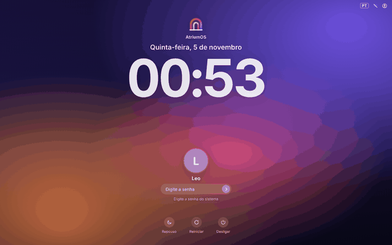

# AtriumOS



Sistema operacional baseado no **Debian 13 (trixie)** com visual inspirado no macOS:
barra de menus no alto, Dock embaixo, Launchpad, Busca na tecla Super, apps do
Linux, do Android e do Windows, e pontos de restauração automáticos.

Este repositório gera **duas coisas de teste**, direto pelo GitHub:

| O quê | Onde fica | Como gerar |
|---|---|---|
| **ISO do AtriumOS 0.1** (pen drive / máquina virtual) | `iso/` | Actions › *Construir a ISO do AtriumOS* › Run workflow |
| **Pórtico compilado** (nome e ícone próprios) para Linux, Windows e Mac | `portico/compilar/` | Actions › *Compilar o Pórtico* › Run workflow |
| **Pórtico 0.1 prévia** (perfil sobre o Firefox instalado) | `portico/` | Actions › *Pórtico (prévia de teste)* › Run workflow |

Os arquivos prontos aparecem em **Releases** (lado direito da página do repositório).

> **A ISO não vem dentro deste zip.** Ela tem 2 a 3 GB e é **gerada pelo GitHub** a partir destes arquivos.
>
> **No Mac, a pasta `.github` fica escondida** (começa com ponto). No Finder, aperte
> **Cmd + Shift + .** para mostrar. Ela precisa ir para o GitHub junto com o resto.

---

## Passo a passo (primeira vez)

1. Crie uma conta em <https://github.com> (grátis).
2. Crie um repositório novo chamado `atriumos` (**Public**: as Actions são grátis em repositórios públicos).
3. Envie todos os arquivos desta pasta: na página do repositório, *Add file › Upload files*,
   arraste o conteúdo da pasta e clique em *Commit changes*.
   (A pasta `.github` precisa ir junto. Se o navegador não enviar pastas que começam com ponto,
   use o GitHub Desktop ou `git push`.)
4. Abra a aba **Actions**, clique em *Construir a ISO do AtriumOS* › **Run workflow**.
   Leva cerca de **1 a 2 horas**.
5. Quando terminar, a ISO estará em **Releases**. Se passar de 2 GB, ela vem dividida em
   partes, e as notas do lançamento explicam como juntar.

## Como testar a ISO

- **Máquina virtual (mais seguro):** VirtualBox, VMware ou GNOME Boxes com 4 GB de memória,
  2 processadores e 30 GB de disco; ative **EFI** nas opções.
- **Pen drive:** grave com o balenaEtcher ou o Rufus (modo DD), ligue o computador pelo pen drive
  e escolha **AtriumOS**. Dá para usar sem instalar; para instalar, clique em **Instalar o AtriumOS**.

## Como o AtriumOS funciona

O AtriumOS liga **direto na interface do projeto**: a mesma de `shell/index.html`, com a tela de
boot, a configuração inicial (o "átrio"), a tela de login, a Dock, o Launchpad, a Busca, os apps,
o Palco, o Mission Control e tudo o mais. Ela roda em tela cheia sobre o Debian 13
(compositor **cage** + motor **Chromium**), sem outra área de trabalho por baixo.

Um serviço local (`/usr/lib/atriumos/shell-server.py`) liga a interface ao sistema de verdade:
**Desligar**, **Reiniciar**, **Repouso** e **Instalar o AtriumOS neste computador**
(no menu do logo, quando ligado pelo pen drive; abre o instalador Calamares por cima).

Para mudar o AtriumOS, edite `shell/index.html` e envie: a próxima ISO já sai com a mudança.

## Construir no seu computador (opcional)

Num Debian 13, como root: `cd iso && ./build.sh`
(`ATRIUM_ANDROID=0` ou `ATRIUM_WINDOWS=0` deixam esses recursos de fora.)

## Estrutura

```
iso/auto/config            opções do live-build
iso/config/package-lists/  pacotes da ISO
iso/config/hooks/normal/   ajustes feitos durante o build
iso/config/includes.chroot arquivos copiados para o sistema (layout do KDE, Pórtico, scripts)
iso/branding/              tela de boot, instalador e menu do pen drive
portico/                   Pórtico: perfil, página inicial, extensão e instaladores
assets/                    logos, ícones e papéis de parede
```

## Disparar as compilações sem clicar

Enviar qualquer commit para o ramo `construir/iso` gera a ISO, e para `construir/portico`
compila o Pórtico. (Também dá para usar *Actions › Run workflow*.)
