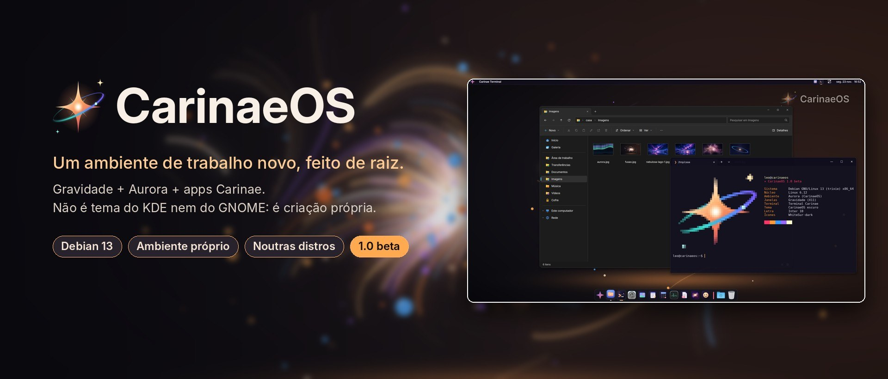
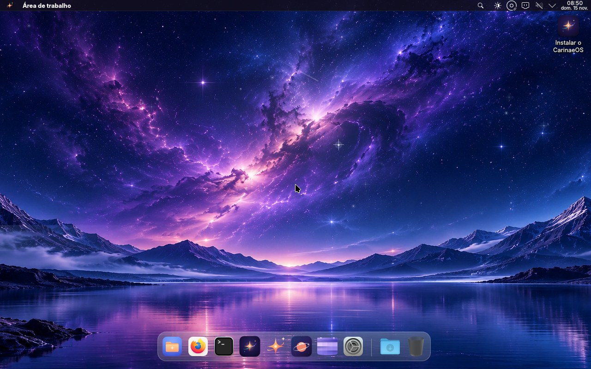
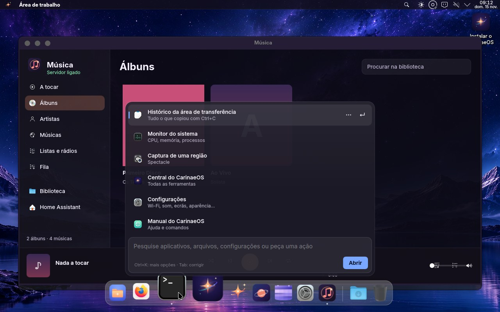
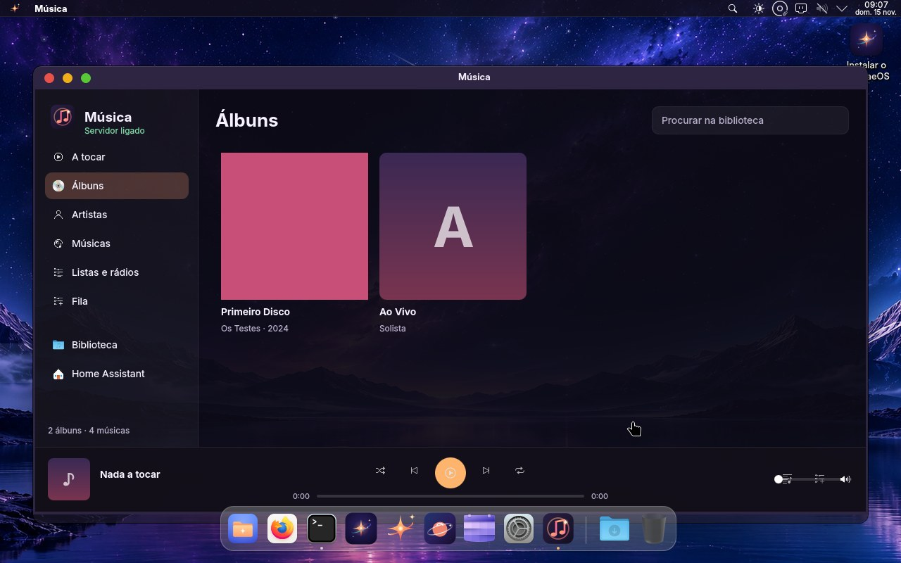
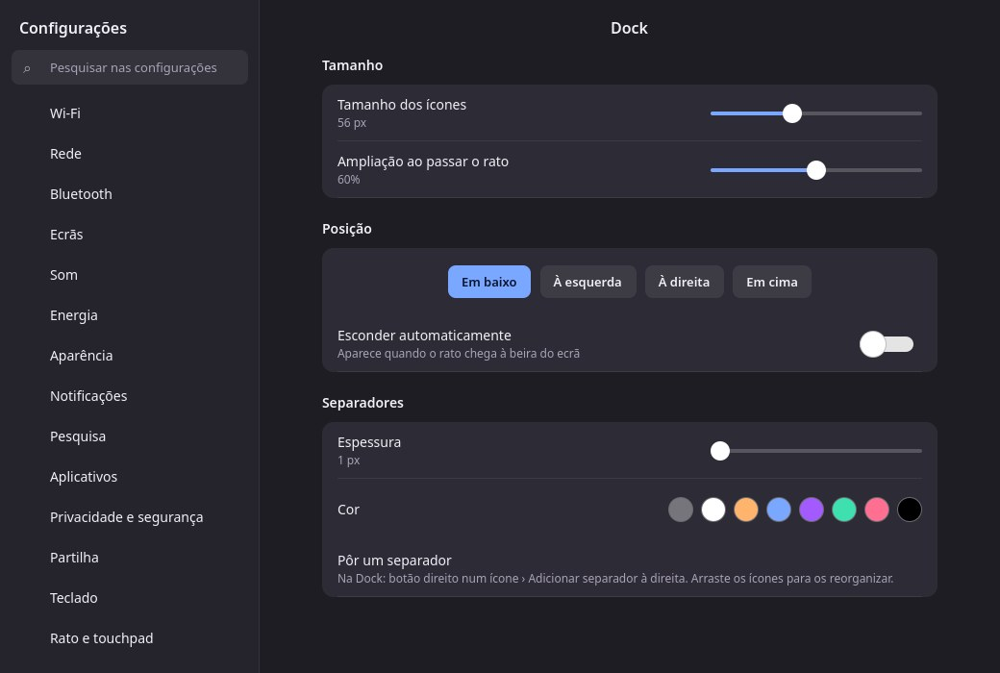
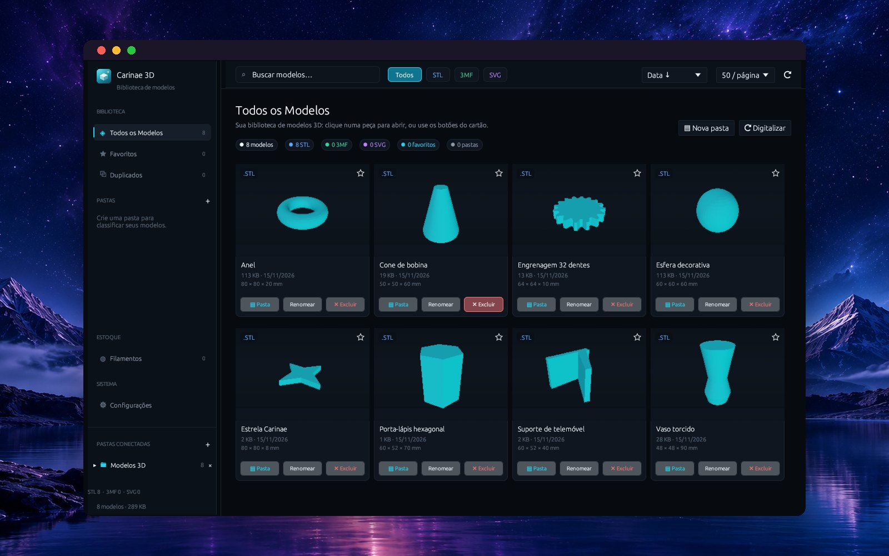

<p align="center">
  
</p>

<p align="center">
  <a href="../../releases/latest"><b>⬇ Baixar a ISO (versão atual)</b></a> ·
  <a href="#-experimentar-em-5-minutos">Experimentar</a> ·
  <a href="#-launchpad-pesquisa-e-deck">Launchpad, Pesquisa e Deck</a> ·
  <a href="#-como-é-feito">Como é feito</a>
</p>

---

**CarinaeOS** é um sistema operacional para computadores, feito para quem quer um Linux
**bonito e fácil desde o primeiro minuto**, sem precisar abrir o terminal.
Ele junta a solidez do **Debian 13** com o **KDE Plasma 6** e dá-lhe uma cara nova: Dock com lupa,
barra no topo, um Launchpad em vidro fosco com categorias e Deck, a **Pesquisa** com ações
(<kbd>Ctrl</kbd>+<kbd>Espaço</kbd>), Configurações e instalador no estilo do Fedora, uma loja de aplicativos própria e um painel de efeitos.

O nome vem de **Eta Carinae**, uma das estrelas mais brilhantes e instáveis da nossa galáxia.
A estrela de quatro pontas é o símbolo do sistema; o papel de parede é uma nebulosa violeta
sobre um lago espelhado.

> **Estado:** versão de testes (*release candidate*). Já dá para usar e instalar, mas ainda pode
> ter arestas. Encontrou alguma coisa? Abra uma [*issue*](../../issues).
> Durante os testes fica publicada **só a versão mais recente**: cada nova versão substitui a anterior.

## ✨ Destaques

<table>
  <tr>
    <td width="50%"></td>
    <td width="50%"></td>
  </tr>
  <tr>
    <td><b>Área de trabalho</b>: a nebulosa sobre o lago (também em versão animada), barra escura no topo e a Dock de vidro, que pode reorganizar e dividir com separadores.</td>
    <td><b>Tela de entrada</b>: relógio grande e a data em português, a sua foto e o céu desfocado ao fundo.</td>
  </tr>
  <tr>
    <td width="50%"></td>
    <td width="50%"></td>
  </tr>
  <tr>
    <td><b>Launchpad</b>: clique na estrela (ou na tecla ⊞/⌘): categorias em cartões, favoritos, mais usados, o Deck e o detalhe de cada aplicativo, em vidro fosco.</td>
    <td><b>Pesquisa</b> (Ctrl+Espaço ou a lupa): aplicativos, arquivos indexados, configurações e ações rápidas, como o volume ou o brilho, e abre na hora.</td>
  </tr>
  <tr>
    <td width="50%"></td>
    <td width="50%"></td>
  </tr>
  <tr>
    <td><b>Música</b>: biblioteca com capas e letras, listas e rádios, por cima do MPD. As listas aparecem como fontes no Home Assistant.</td>
    <td><b>Configurações</b> no estilo do Fedora. Na Dock: tamanho, ampliação, posição (embaixo, ao lado, em cima), esconder, e a cor e a espessura dos separadores.</td>
  </tr>
  <tr>
    <td width="50%"></td>
    <td width="50%"></td>
  </tr>
  <tr>
    <td><b>Central CarinaeOS</b>: todas as ferramentas do sistema num só lugar: Supernova, Órbita (loja), Casa, Calendários, Cadeado…</td>
    <td><b>Inicialização com a estrela</b>: do menu de inicialização ao instalador, tudo com a marca CarinaeOS.</td>
  </tr>
  <tr>
    <td colspan="2"></td>
  </tr>
  <tr>
    <td colspan="2"><b>Carinae 3D</b> (novo, já instalado): a biblioteca dos seus modelos <b>STL, 3MF e SVG</b> em miniaturas 3D, com pastas, favoritos, duplicados, stock de filamentos e um clique para abrir no fatiador (ElegooSlicer, OrcaSlicer, Bambu Studio, PrusaSlicer, Cura…). Lê também pastas da rede.</td>
  </tr>
</table>

### Novidades da rc17

- **Ambientes no Launchpad**: os cartões passam a ser *ambientes* que monta como quiser — crie, mude o nome e a cor,
  coloque uma **imagem como marca de água**, arraste para mudar a ordem (botão **Editar**) e **tranque com senha**.
  O ambiente **CarinaeOS** vem sempre com tudo o que é do sistema (Central, Música, Órbita, Carinae Casa…), e há a vista
  *Sem ambiente* para arrumar o resto. Cada aplicativo fica num só ambiente (botão direito › *Mover para*).
- **Deck de ações**: luzes e cenas do Home Assistant, Não incomodar, Luz noturna, Wi-Fi, Bluetooth, modo de energia,
  saída de som, rádios e playlists — cada tecla mostra o estado e acende quando está ligada.
- **Cadeado em todo o lado**: botão direito em qualquer ícone (Launchpad, Dock, Deck, Arquivos) › *Trancar com senha* /
  *Destrancar*, também para aplicativos e ambientes. A senha é pedida dentro do próprio Launchpad.
- **Contas online com login próprio do CarinaeOS**: entre com a conta **Google** no navegador e veja os emails ligados;
  o **Google Drive** fica numa pasta dos Arquivos e os **calendários** aparecem no Merkuro. Também Nextcloud e ownCloud.
- **Carinae Casa** é agora um aplicativo próprio (ligado ao Home Assistant), que pode colocar na Dock ou em qualquer ambiente.
- **Música**: o que está tocando aparece na **barra de cima**, com controles e volume; listas novas (de uma pasta, com
  músicas escolhidas, editar e mudar a ordem); rádios; e as listas, pastas e rádios novas chegam **sozinhas ao Home Assistant**.
- **Placas de vídeo**: a Central escolhe o controlador certo para cada placa NVIDIA — o atual (GTX 750 em diante, RTX),
  o **470 para as Kepler** (GT 710/730, GTX 600/700, com a sessão X11 e as afinações que tiram os solavancos) ou o livre
  (nouveau) nas muito antigas —, e os de AMD e Intel.
- **Dock como no Mac**: só o vidro em repouso, cresce com o mouse por cima das janelas, que param na borda dela;
  pré-visualização das janelas ao passar o mouse e os nomes numa janelinha.
- **AppImages de impressão 3D** (OrcaSlicer, ElegooSlicer, Bambu Studio, Cura) funcionam logo, e os navegadores em
  Flatpak já criam aplicativos (PWA) com ícone.
- **Janelas menos transparentes** e com os botões do Mac também nos navegadores instalados como Flatpak.

E ainda:

- **Visual Vidro**: janelas translúcidas com desfoque, botões redondos, ícones coloridos e
  papéis de parede com **fotografias reais do céu do Atacama** (ESO) com a estrela do CarinaeOS a brilhar,
  da inicialização animada e da tela de entrada até à área de trabalho.
- **Central CarinaeOS**: todas as ferramentas num só lugar — Supernova, Órbita, Casa, Ambiente,
  Calendários, Janelas em zonas, Cadeado, Etiquetas, Histórico do Ctrl+C, Drivers, Acesso remoto (SSH) e Privacidade.
- **Janelas em zonas**: esquemas prontos (2 ou 3 colunas, grade, principal + duas); arraste com Shift para encaixar.
  E **áreas de trabalho** como os Spaces do Mac (<kbd>Ctrl</kbd>+<kbd>⊞</kbd>+<kbd>←/→</kbd>, <kbd>⊞</kbd>+<kbd>W</kbd>).
- **Histórico do Ctrl+C** com <kbd>⊞</kbd>+<kbd>V</kbd>.
- **Drivers e hardware**: deteta placa NVIDIA, Wi-Fi, Bluetooth, impressoras e scanners, leitor de impressão digital,
  mouses Logitech e de jogos, e instala o que falta com um clique.
- **Sessão sem rastro**: “Convidado” na tela de entrada; tudo vive na memória e desaparece ao sair.
- **Modo escuro em todo o lado**, até no Chrome, no Firefox e nos aplicativos GTK e Flatpak.
- **Janelas de senha com a marca CarinaeOS** sempre que o sistema pede permissão.
- **Um só estilo, o do CarinaeOS**: barra em cima, Dock embaixo, e nenhum nome técnico à vista — o Terminal é “Terminal”, o visualizador de fotos é “Fotos”, o de PDF é “Documentos”.
- **Configurações próprias**, como as do Fedora: Wi-Fi, Bluetooth, telas, som, energia, aparência, pesquisa, compartilhamento, data e hora, usuários e “Sistema” (sobre o computador).
- **Instalador e configuração inicial como no Fedora**: passos numerados à esquerda e, no primeira inicialização, Wi-Fi, privacidade, aparência e contas online.
- **Carinae Casa**: painéis do Home Assistant que monta como quiser (leves, sem travar, mesmo com centenas de aparelhos), com 13 tipos de cartões (botão, luz, lista, sensor,
  gráfico de 24 h, clima, cenas, som e TV, câmera, persianas, tempo, número, texto), e este PC como dispositivo no Home Assistant.
- **Calendários**: conta Google, iCloud (CalDAV) ou qualquer endereço iCal (Google, iCloud, Outlook, feriados), e **Mapas**.
- **Etiquetas** coloridas nos Arquivos, como no Finder, na barra lateral, até em pastas de rede.
- **Papéis de parede em 8K**: o céu do Atacama com a estrela, fotografias do James Webb e do Hubble e desenhos originais.
- **ArtCraft Launcher** já instalado, para baixar os aplicativos da Craft App Suite.
- **AppImage com duplo clique** (por exemplo o Elegoo Slicer para impressoras 3D): o CarinaeOS instala-o no menu,
  com ícone, e oferece pô-lo na Dock.
- **Tela de entrada à sua maneira**: a sua foto e a imagem de fundo do login (Central › Tela de entrada).
- **Todas as janelas com os botões do Mac à esquerda**, com as mesmas cores, também nos aplicativos GTK e nos
  navegadores (Chrome, Chromium, Firefox).
- **Papel de parede animado**: a nebulosa com estrelas a cintilar, estrelas cadentes e reflexos no lago (duas cenas, mais as versões fixas).
- **Dock reorganizável**: arraste os ícones e coloque separadores onde quiser (botão direito). Em **Configurações › Dock**: tamanho, ampliação, posição (embaixo, à esquerda, à direita, em cima), esconder automaticamente e espessura e cor dos separadores.
- **Música**: leitor e biblioteca com capas e letras (sincronizadas quando existem), listas e rádios — a porta de entrada do **MPD**. As listas aparecem como **fontes** no Home Assistant (integração Music Player Daemon), e funciona com o `mpc` e qualquer cliente MPD.
- **Compartilhamento de pastas num clique** (Configurações › Compartilhamento): liga o Samba, abre logo a escolha da pasta e mostra o endereço para Windows, Mac e celulares. O **SSH** mostra IP, usuário e os comandos prontos a copiar.
- **Meus documentos** com a barra lateral como a do Explorador do Windows, e **pastas de rede como no Fedora** (Configurações › Rede › Ligar a um servidor; Compartilhamento › Compartilhar uma pasta).
- **Barra de cima** escura e legível, com o nome do aplicativo em negrito, o seu menu e a lupa da Pesquisa. As janelas maximizadas ficam entre a barra de cima e a Dock, sem nada escondido por trás dela.
- **NumLock ligado** ao entrar, para escrever a senha logo.
- **Boas-vindas** depois de instalar, a mostrar tudo o que o sistema tem.

- **Acesso remoto por SSH** com um interruptor (Central › Acesso remoto), com o comando certo para entrar a partir de outro computador.
- **Cadeado em pastas, arquivos e aplicativos**: botão direito → *Trancar com senha*. A pasta fica no mesmo
  lugar com um cadeado e só abre com a senha (cifrada com AES-256).
- **Céu vivo** (liga-se no Supernova): o fundo de tela muda de tom ao longo do dia — madrugada, manhã, tarde e noite.
- **Alt+Tab em Flip 3D**, como no Windows Vista, ou em grade, como no Mac.
- **Tudo em português**, da inicialização ao instalador.

## ✦ Launchpad, Pesquisa e Deck

**Launchpad** (estrela da Dock ou tecla <kbd>⊞</kbd>): a tela cheia em vidro fosco sobre o papel de parede.
À esquerda, as vistas — *Início*, *Todos os aplicativos*, *Instalados recentemente*, *Favoritos* (os da Dock), *Mais usados* e *Deck* — e as
categorias com o número de aplicativos. No *Início*, cada categoria é um cartão colorido com os seus aplicativos
(Internet, Gráficos, Multimídia, Jogos, Sistema…). À direita, o detalhe do aplicativo por baixo do mouse:
descrição, **Abrir**, as **ações rápidas** (Nova janela, Nova janela privada…), *Fixar na Dock*, *Mover para* (ambiente)
e *Trancar com senha*. No *Início*, os cartões são **ambientes** que organiza como quiser: o botão **Editar** deixa
arrastá-los, mudar a cor e colocar uma imagem como marca de água; o botão direito cria, renomeia, fixa em primeiro, esconde
ou tranca com senha.
Escreva para pesquisar; setas e Enter também funcionam.

**Deck**: uma grelha de teclas grandes, como um Stream Deck, para **fazer coisas** (os aplicativos vivem na Dock e nos
ambientes): as luzes, cenas e aparelhos do **Home Assistant**, *Não incomodar*, *Luz noturna*, Wi-Fi, Bluetooth, modo de
energia, a **saída de som**, tocar uma **rádio ou playlist**, captura de tela, todas as janelas, bloquear… Cada tecla mostra
o estado e acende quando está ligada. *Adicionar* abre a lista de ações; também aceita comandos e sites.

**Pesquisa** (<kbd>Ctrl</kbd>+<kbd>Espaço</kbd> ou a lupa da barra de cima), no modelo da nova pesquisa do Windows:
a caixa embaixo e os resultados por cima. Encontra **aplicativos**, **arquivos** (pelo nome e pelo conteúdo — a
indexação vem ligada) e **configurações**, e faz **ações** ali mesmo: “diminuir volume” mostra o volume com um
controle deslizante e o botão *Diminuir*; “ativar modo claro”, “desligar o wi-fi”, “brilho”, “lado a lado”,
“bloquear”… Percebe erros de escrita e sugere a palavra certa. Também faz contas, mostra o tempo (“tempo em Lisboa”),
o uso do computador, o histórico da área de transferência, abre sites e pesquisa na web.

## 📖 Manual

O **[Manual do CarinaeOS](docs/manual/00-indice.md)** explica tudo: a área de trabalho, as ferramentas,
arquivos e discos, **HD na rede e pastas compartilhadas** (SMB/NAS, NFS, SSH), programas (apt, Flatpak, AppImage),
hardware e drivers, o Debian, o kernel Linux e uma referência grande de **comandos do terminal**.
Vem dentro do sistema como o aplicativo *Manual*, com pesquisa.

## ⌨️ Atalhos úteis

| Atalho | O que faz |
|---|---|
| <kbd>⊞</kbd> (tecla Windows / ⌘) | Abre o Launchpad |
| <kbd>Ctrl</kbd>+<kbd>Espaço</kbd> (ou <kbd>⊞</kbd>+<kbd>Espaço</kbd>) | Pesquisa: aplicativos, arquivos, ações e configurações |
| <kbd>Alt</kbd>+<kbd>F2</kbd> | KRunner (a pesquisa do KDE) |
| <kbd>Alt</kbd>+<kbd>Tab</kbd> | Troca de janela em Flip 3D |
| <kbd>⊞</kbd>+<kbd>V</kbd> | Histórico do Ctrl+C |
| <kbd>⊞</kbd>+<kbd>W</kbd> | Todas as janelas e áreas de trabalho |
| <kbd>⊞</kbd>+<kbd>T</kbd> | Desenhar as zonas das janelas (arraste com Shift para encaixar) |
| <kbd>Print</kbd> | Captura de tela |

## 🚀 Experimentar em 5 minutos

1. Em [**Releases**](../../releases), abra a versão mais recente e baixe a ISO:

   - **Num arquivo único** (recomendado): o link do **SourceForge** no topo das notas da versão,
     ou o arquivo `.torrent`, que também baixa do SourceForge mesmo sem ninguém compartilhando.
   - **Em partes**, pelo GitHub (que não aceita arquivos com mais de 2 GB): baixe **todas as partes**
     (`CarinaeOS-1.0-amd64.iso.parte00`, `parte01`, …) para a mesma pasta e junte-as:
     - **Windows**: abra a pasta, clique na barra de endereço, escreva `cmd` e Enter. Depois:
       ```
       copy /b CarinaeOS-1.0-amd64.iso.parte00 + CarinaeOS-1.0-amd64.iso.parte01 CarinaeOS-1.0-amd64.iso
       ```
       No **PowerShell**, coloque `cmd /c` antes do mesmo comando.
     - **macOS / Linux**:
       ```
       cat CarinaeOS-1.0-amd64.iso.parte* > CarinaeOS-1.0-amd64.iso
       ```

2. **Confirme que a ISO é a original** (recomendado). Baixe também `SHA256SUMS` e `SHA256SUMS.asc`.
   - Que veio inteira: `certutil -hashfile CarinaeOS-1.0-amd64.iso SHA256` (Windows) ou
     `sha256sum -c SHA256SUMS` (Linux; no Mac, `shasum -a 256 -c SHA256SUMS`). O código tem de ser igual.
   - Que foi o CarinaeOS que a publicou (assinatura GPG, no Linux ou Mac com GnuPG):
     ```
     curl -fsSL https://raw.githubusercontent.com/leothemurphy/CarinaeOS/main/carinaeos-chave.asc | gpg --import
     gpg --verify SHA256SUMS.asc SHA256SUMS
     ```
     Tem de aparecer **Good signature from "CarinaeOS…"** (ou a mesma frase em português), com a impressão digital
     publicada em [Segurança e privacidade](#-segurança-e-privacidade).

3. **Numa máquina virtual** (VirtualBox, VMware, GNOME Boxes…): crie uma máquina
   *Linux → Debian 64-bit* com **4 GB de memória**, **2 processadores**, **30 GB de disco**, vídeo
   **VMSVGA com 128 MB** e aceleração 3D. Use a ISO como disco de inicialização.
   No VirtualBox, marque *“Pular instalação desassistida”*.

   **Num computador de verdade**: grave a ISO num pen drive de 4 GB ou mais com o
   [balenaEtcher](https://etcher.balena.io/) ou o [Rufus](https://rufus.ie/) (modo *DD*) e inicie por ele.

4. Na tela de entrada: usuário **CarinaeOS**, senha **`live`**.
5. Gostou? Clique duas vezes em **Instalar o CarinaeOS**, na área de trabalho.
   O instalador é guiado e aceita senhas simples.

> **Dica:** na sessão de teste (sem instalar), tudo o que instala ou muda fica na memória e
> desaparece quando desliga. Para salvar, instale o CarinaeOS no disco.

**Requisitos:** processador de 64 bits (x86-64), 4 GB de memória e 30 GB de disco. Funciona com e sem UEFI.

## 🔒 Segurança e privacidade

**Sem telemetria.** Nenhum app do CarinaeOS envia dados de uso, nem há conta obrigatória.
O CarinaeOS só se conecta à internet quando você usa algo que precisa dela:

| Quando | Para onde | O quê |
|---|---|---|
| Atualizações (app e correções automáticas) | `deb.debian.org`, `security.debian.org` | Os repositórios oficiais do Debian |
| Instalador | `geoip.kde.org` | Sugerir o fuso horário (pode mudar à mão) |
| Pesquisa: “tempo em …” | `wttr.in` | O nome da cidade que escreveu |
| Pesquisa na web | `duckduckgo.com` | Só quando escolhe pesquisar na web |
| Música: letras e capas | `lrclib.net`, `musicbrainz.org`, `coverartarchive.org` | Artista e título da música |
| Órbita (loja) | `dl.flathub.org` | Lista e downloads de aplicativos |
| Contas online (se ligar) | Google (`accounts.google.com`, `googleapis.com`), Nextcloud, iCloud | Login, Drive e calendários da sua conta |

**Ligado de origem**
- **Firewall** (ufw): bloqueia tudo o que chega de fora. SSH, pastas compartilhadas e a Música para o
  Home Assistant só abrem quando os liga, e só para a rede de casa, nunca para a internet. Fica em *Central › Firewall*.
- **Correções de segurança automáticas**: as do Debian são instaladas sozinhas todos os dias. O sistema nunca reinicia sozinho
  e avisa quando é preciso reiniciar. O resto passa pelo app **Atualizações**, que cria antes um **ponto de restauro** (Timeshift).
- **Secure Boot**: inicia com o shim e o núcleo assinados pelo Debian. Os drivers NVIDIA são assinados com uma chave
  própria do computador (MOK), que a Central ajuda a registrar.

**Ações de administrador.** Nunca se corre um “terminal como administrador” genérico. Cada ação tem um
ajudante próprio em `/usr/lib/carinaeos/`, com mensagem própria no pedido de senha (polkit, `auth_admin_keep`).
Cada ajudante só aceita os argumentos que conhece, e os valida:

| Ajudante | Faz | Aceita |
|---|---|---|
| `atualizar` | Ponto de restauro, atualizar, voltar a um ponto | `ponto`, `sistema`, `restaurar`/`apagar` + nome de ponto (data) |
| `instalar-pacotes` | Drivers e firmware da Central | Nomes de pacotes válidos que existam no Debian |
| `placa-video` | Driver NVIDIA (atual ou 470) e chave do Secure Boot | `atual`, `kepler`, `mok` |
| `firewall` | Ligar/desligar, abrir/fechar serviços | Serviços fixos: `ssh`, `partilha`, `musica` |
| `partilha` | Samba e pastas compartilhadas | Nome `[A-Za-z0-9_-]`, pasta existente, `ro`/`rw`/`livre`; senha pela entrada, nunca na linha de comando |
| `ssh` | Ligar/desligar o SSH | `ligar`, `desligar` |
| `convidado` | Sessão de convidado sem rastro | `ligar`, `desligar` |
| `fundo-entrada` | Imagem da tela de entrada | Uma imagem (é aberta e convertida, não copiada tal como está) |

**Os seus dados**
- **Pastas compartilhadas**: com senha por padrão (usuário + senha da rede). Sem senha só em leitura, e as permissões das
  pastas nunca são alteradas.
- **Cadeado**: pastas e arquivos trancados ficam **cifrados** (GnuPG, AES-256). Aplicativos e ambientes trancados pedem a
  senha para abrir, mas não são cifrados. Para proteger o disco todo, marque **Criptografar o sistema** no instalador.
- **Contas Google**: login próprio no seu computador (OAuth com PKCE, resposta em `127.0.0.1`). Os tokens ficam só em
  `~/.local/share/carinaeos/contas`, legíveis só por você, e são revogados ao desligar a conta.
- **Sessão de convidado**: pasta pessoal só na memória, apagada ao sair.

**ISO assinada.** Cada versão publica `SHA256SUMS` e `SHA256SUMS.asc`, assinado com a chave do CarinaeOS
([`carinaeos-chave.asc`](carinaeos-chave.asc)). A impressão digital é:

```
94E2 2F7D 9EF1 1315 1B87  CB4E 180C FE53 9CF1 308F
```

**Encontrou uma falha de segurança?** Veja [SECURITY.md](SECURITY.md). Por favor, não a publique numa issue aberta.

## 🛠 Como é feito

O CarinaeOS é montado com o [live-build](https://live-team.pages.debian.net/live-manual/) do
Debian. A ISO é gerada automaticamente pelo **GitHub Actions** sempre que o arquivo
[`carinae-debian/VERSAO`](carinae-debian/VERSAO) muda, e é publicada em *Releases*.

```
carinae-debian/              a receita da ISO
├── construir.sh             monta tudo e chama o live-build
├── VERSAO                   mudar este arquivo gera uma nova ISO
├── auto/config              opções do live-build (Debian 13, inicialização, idioma)
├── config/
│   ├── package-lists/       os pacotes que vão no sistema
│   └── hooks/               ajustes feitos dentro do sistema (marca, senhas, atalhos…)
└── sistema/                 arquivos copiados para dentro do sistema
    ├── usr/bin/             carinaeos-cadeado, carinaeos-comando, carinaeos-orbita, …
    └── usr/share/carinaeos/ os aplicativos próprios (Python + Qt Quick)
        ├── comando/         a Pesquisa (Ctrl+Espaço)
        ├── configuracoes/   as Configurações
        ├── boasvindas/      a configuração inicial
        ├── orbita/          a loja
        ├── casa/            o Carinae Casa (Home Assistant)
        ├── musica/          a Música (MPD)
        └── supernova/       o painel de efeitos

carinae/tema/                o visual
├── plasmoid/                a Dock (com o Launchpad e o Deck) e o menu da estrela
├── lookandfeel/             a disposição da área de trabalho
├── plasmastyle/  cores/     o estilo do Plasma e o esquema de cores
├── sddm/  plymouth/  grub/  tela de entrada, carregamento e menu de inicialização
├── icones/                  a estrela e os ícones dos aplicativos próprios
└── wallpaper/               o papel de parede padrão

carinae/apps/carinae-3d/     o Carinae 3D (Rust), compilado durante a construção da ISO
carinae/lfs/                 a primeira versão, feita do zero com Linux From Scratch (arquivo histórico)
```

### Gerar a ISO você mesmo

- **No GitHub:** aba **Actions → CarinaeOS ISO → Run workflow**. Leva cerca de 20 minutos e a ISO
  aparece em *Releases*.
- **No seu computador**, dentro de um Debian 13 (ou de um contentor `debian:trixie` com
  `--privileged`), como root:
  ```
  apt install live-build librsvg2-bin fonts-dejavu-core apt-utils git cmake g++ make
  cd carinae-debian && ./construir.sh
  ```

## 👥 Autores

O CarinaeOS foi idealizado e desenvolvido por **Leonardo Mendes**, em parceria com o
**Claude**, a IA da [Anthropic](https://www.anthropic.com/), do primeiro rascunho em
Linux From Scratch à versão atual: o visual, a Dock, o Launchpad, a Pesquisa, as Configurações, a Órbita, o Supernova e a receita da ISO.

## 🙏 Créditos

O CarinaeOS existe graças a projetos livres incríveis:
[Debian](https://www.debian.org/), [KDE Plasma](https://kde.org/plasma-desktop/),
[Calamares](https://calamares.io/), [Flathub](https://flathub.org/),
o tema e os ícones [WhiteSur](https://github.com/vinceliuice/WhiteSur-kde) de Vince Liuice (GPL-3.0), recoloridos para o CarinaeOS,
as fotografias do [ESO](https://www.eso.org/public/images/) (Y. Beletsky, J. Colosimo, D. Malin, J. Busqué; CC BY 4.0)
e do [ESA/Webb e ESA/Hubble](https://esawebb.org/images/) (CC BY 4.0),
o [ArtCraft Launcher](https://github.com/storytold/craft-launcher)
e a fonte [Inter](https://rsms.me/inter/) (SIL OFL).
O código próprio do CarinaeOS (Dock, Launchpad, Pesquisa, Configurações, Órbita, Supernova, tema) é distribuído sob a
**GPL-2.0-or-later**, como o KDE em que se baseia.

<p align="center"><sub>Desenvolvido com ✦ por <b>Leonardo Mendes</b> e <b>Claude</b> (Anthropic)</sub></p>
