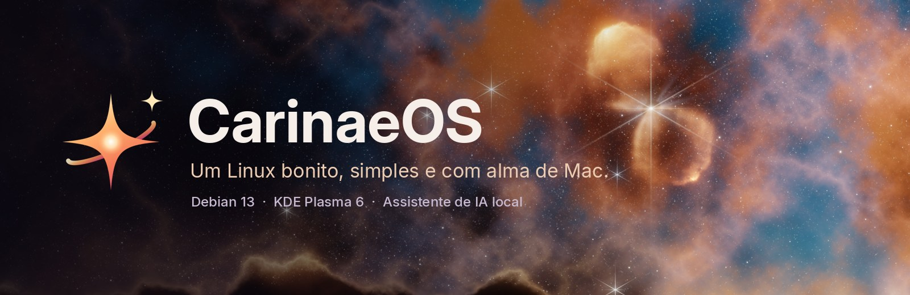
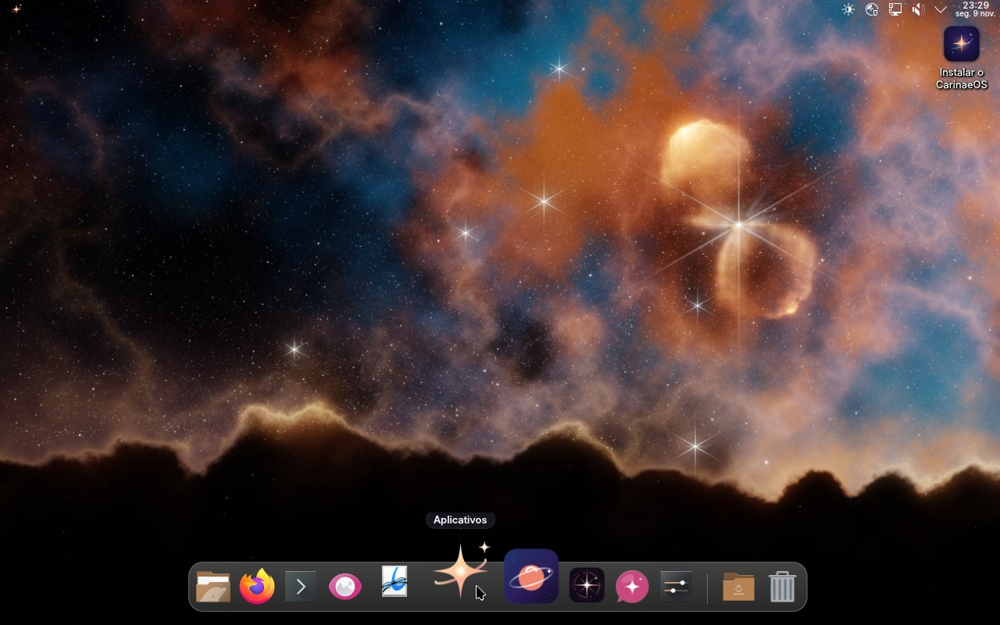
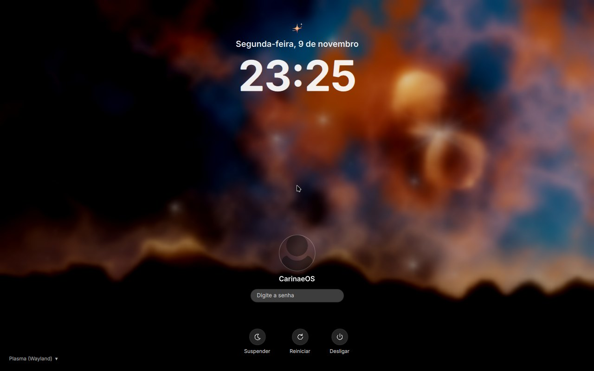
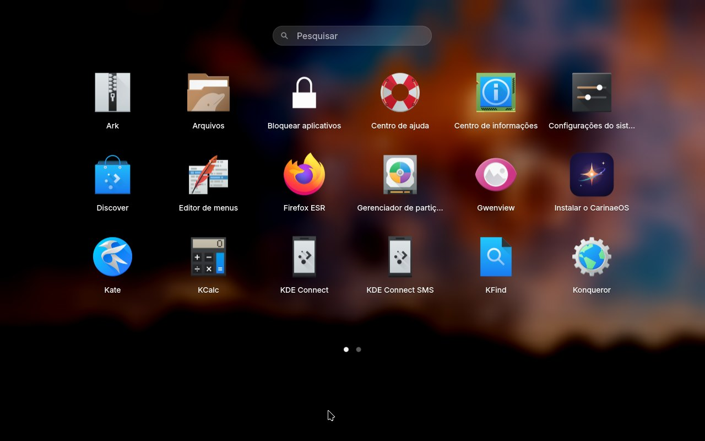
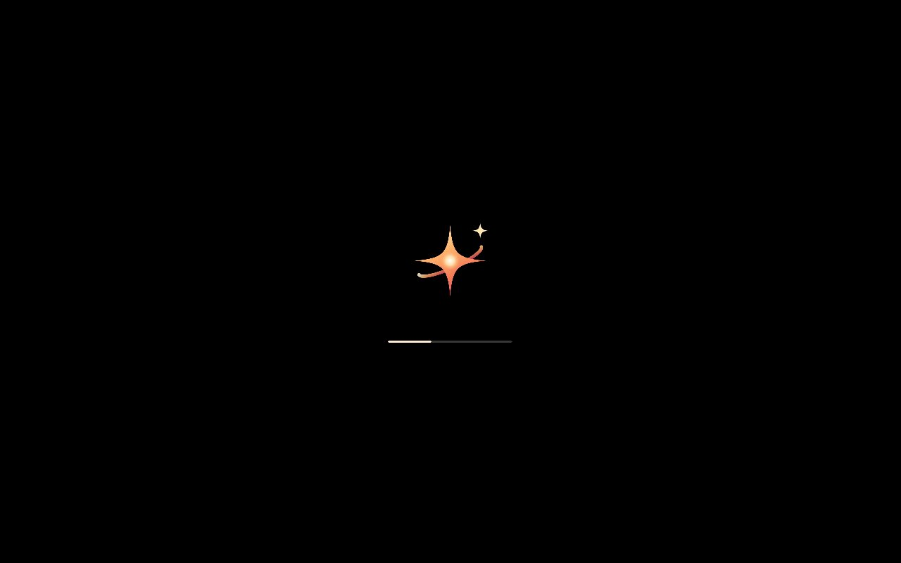
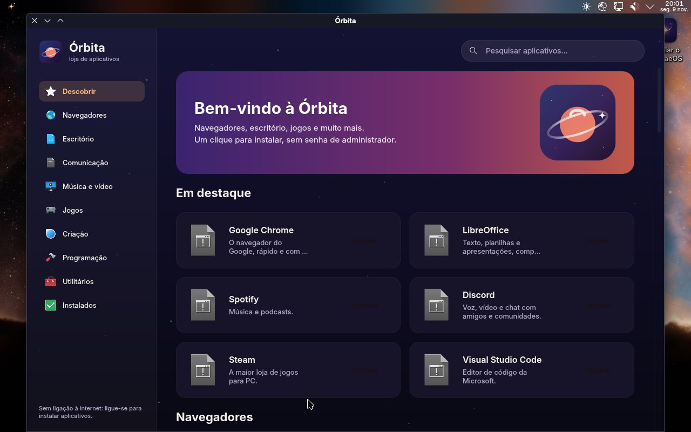
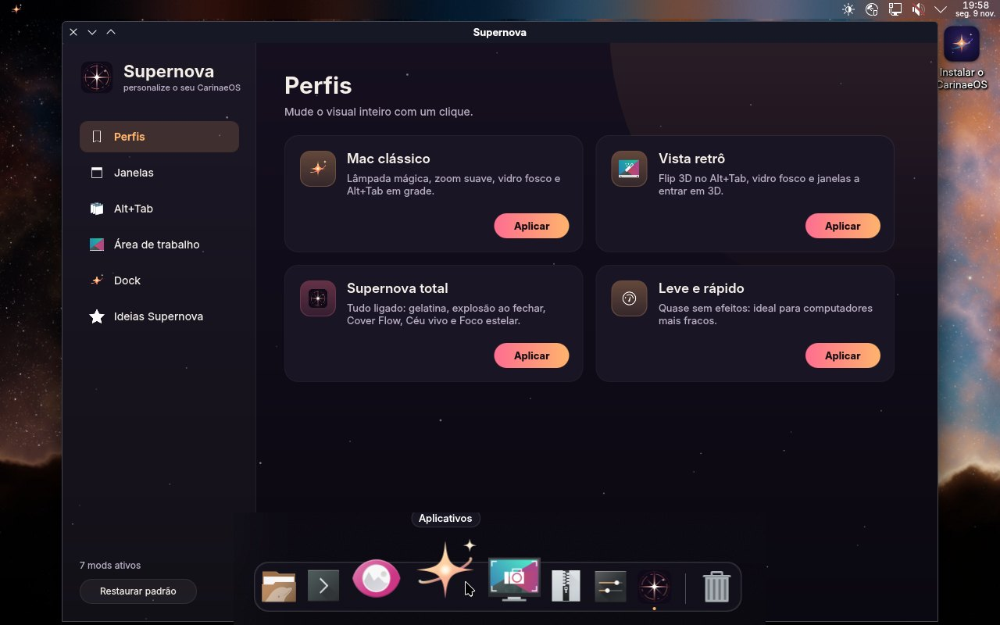
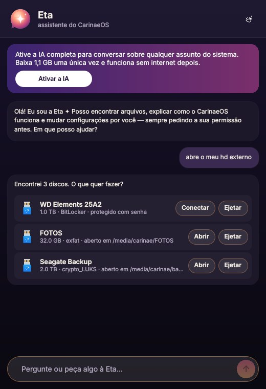

<p align="center">
  
</p>

<p align="center">
  <a href="../../releases"><b>⬇ Baixar a ISO</b></a> ·
  <a href="#-experimentar-em-5-minutos">Experimentar</a> ·
  <a href="#-eta-a-assistente-do-sistema">Conhecer a Eta</a> ·
  <a href="#-como-é-feito">Como é feito</a>
</p>

---

**CarinaeOS** é um sistema operacional para computadores, feito para quem quer um Linux
**bonito e fácil desde o primeiro minuto**, sem precisar abrir o terminal.
Ele junta a solidez do **Debian 13** com o **KDE Plasma 6** e dá-lhe uma cara nova: Dock com lupa,
barra no topo, Launchpad, uma loja de aplicativos própria, um painel de efeitos e a **Eta**, uma
assistente de IA que roda **no seu próprio computador**.

O nome vem de **Eta Carinae**, uma das estrelas mais brilhantes e instáveis da nossa galáxia.
Ela aparece no fundo de tela, e a estrela de quatro pontas é o símbolo do sistema.

> **Estado:** versão de testes (*release candidate*). Já dá para usar e instalar, mas ainda pode
> ter arestas. Encontrou alguma coisa? Abra uma [*issue*](../../issues).

## ✨ Destaques

<table>
  <tr>
    <td width="50%"></td>
    <td width="50%"></td>
  </tr>
  <tr>
    <td><b>Área de trabalho</b>: barra no topo com o menu do aplicativo aberto, e Dock de vidro
        que amplia os ícones ao passar o mouse, com <b>Downloads</b> e <b>Lixeira</b> no fim.</td>
    <td><b>Tela de entrada</b>: relógio grande, senha embaixo e o céu da Eta Carinae ao fundo.
        Aceita senhas simples, como um PIN de 4 a 6 números.</td>
  </tr>
  <tr>
    <td></td>
    <td></td>
  </tr>
  <tr>
    <td><b>Launchpad</b>: clique na estrela (ou aperte a tecla ⊞/⌘) e veja todos os aplicativos
        em páginas, com busca.</td>
    <td><b>Arranque com a estrela</b>: do menu de arranque à tela de carregamento e ao instalador,
        tudo com a marca CarinaeOS. Nenhum logotipo do Debian ou do KDE à vista.</td>
  </tr>
  <tr>
    <td></td>
    <td></td>
  </tr>
  <tr>
    <td><b>Órbita</b>: a loja de aplicativos. Chrome, LibreOffice, Spotify, Discord, VS Code, Steam…
        com um clique, sem senha e com o progresso do download.</td>
    <td><b>Supernova</b>: o painel de personalização. Efeitos de janela (lâmpada mágica,
        gelatina, explosão), Alt+Tab em Flip 3D ou em grade, ajustes da Dock e perfis prontos.</td>
  </tr>
</table>

E ainda:

- **Busca rápida** (<kbd>Ctrl</kbd>+<kbd>Espaço</kbd>), como o Spotlight: encontra aplicativos,
  arquivos e configurações, faz contas, converte unidades e pode perguntar à Eta.
- **Cadeado em pastas, arquivos e aplicativos**: clique com o botão direito → *Bloquear com senha*.
  O que está bloqueado aparece com um cadeado.
- **Céu vivo** (liga-se no Supernova): o fundo de tela muda de tom ao longo do dia — madrugada, manhã, tarde e noite.
- **Alt+Tab em Flip 3D**, como no Windows Vista, ou em grade, como no Mac.
- **Tudo em português**, do arranque ao instalador.

## ✦ Eta, a assistente do sistema



A **Eta** conhece o CarinaeOS por dentro. Pode conversar com ela em português:

| Você diz… | A Eta… |
|---|---|
| “Encontre o meu currículo” | procura na sua pasta pessoal e lista os arquivos com botões **Abrir**, **Mostrar na pasta** e **Bloquear** |
| “Como mudo o fundo de tela?” | explica o passo a passo e oferece-se para abrir a configuração certa |
| “Liga a luz noturna” · “Aumenta o volume” | faz por você |
| “Abre o meu HD externo” | encontra o disco, pede a senha se ele for protegido (BitLocker ou LUKS) e abre-o nos Arquivos |
| “Ejeta o pen drive” | fecha o disco para você tirar o cabo em segurança |
| “Liga à pasta de rede 192.168.1.20/fotos” | pede o usuário e a senha e liga-se ao NAS ou ao outro computador |
| “Quero ligar ao Wi-Fi” | mostra as redes à volta e pede a senha |
| “Verificar atualizações” | diz o que há para atualizar (e o que é de segurança) e instala tudo |
| “Instala o GIMP” · “Abre o terminal” | instala pelo terminal, à sua vista, ou pelo Flathub |

**Nada é feito sem a sua permissão.** Antes de mudar qualquer coisa, a Eta mostra um cartão com o
comando exato e os botões **Permitir** / **Recusar**. As senhas que digita para ela ficam escondidas,
não aparecem na conversa e nunca são enviadas para a IA.

**A IA é local e privada.** Na primeira vez, a Eta pergunta se quer ativar a IA completa: são
1,1 GB baixados uma única vez (modelo Qwen2.5 1.5B, a correr com o llama.cpp). Depois disso,
funciona **sem internet** e nada do que escreve sai do seu computador. Mesmo sem a IA ativada,
a Eta já responde às perguntas mais comuns e faz todas as tarefas da tabela acima.

Abra-a pela Dock, pelo menu da estrela, com <kbd>⊞</kbd>+<kbd>Espaço</kbd>, ou escrevendo uma
pergunta na busca rápida.

<br clear="right">

## ⌨️ Atalhos úteis

| Atalho | O que faz |
|---|---|
| <kbd>⊞</kbd> (tecla Windows / ⌘) | Abre o Launchpad |
| <kbd>Ctrl</kbd>+<kbd>Espaço</kbd> | Busca rápida (como o Spotlight) |
| <kbd>⊞</kbd>+<kbd>Espaço</kbd> | Abre a Eta |
| <kbd>Alt</kbd>+<kbd>Tab</kbd> | Troca de janela em Flip 3D |
| <kbd>Print</kbd> | Captura de tela |

## 🚀 Experimentar em 5 minutos

1. Em [**Releases**](../../releases), abra a versão mais recente e baixe **todas as partes**
   (`CarinaeOS-1.0-amd64.iso.parte00`, `parte01`, …) e o arquivo `.sha256` para a mesma pasta.
   A ISO vem em partes porque o GitHub não aceita arquivos com mais de 2 GB.
2. Junte as partes numa única ISO:

   - **Windows**: abra a pasta, clique na barra de endereço, escreva `cmd` e Enter. Depois:
     ```
     copy /b CarinaeOS-1.0-amd64.iso.parte00 + CarinaeOS-1.0-amd64.iso.parte01 CarinaeOS-1.0.iso
     ```
     No **PowerShell**, ponha `cmd /c` antes do mesmo comando.
   - **macOS / Linux**:
     ```
     cat CarinaeOS-1.0-amd64.iso.parte* > CarinaeOS-1.0.iso
     ```

   Opcional, para confirmar que veio inteira: `certutil -hashfile CarinaeOS-1.0.iso SHA256`
   (Windows) ou `shasum -a 256 CarinaeOS-1.0.iso` (Mac/Linux). O código tem de ser igual ao do `.sha256`.

3. **Numa máquina virtual** (VirtualBox, VMware, GNOME Boxes…): crie uma máquina
   *Linux → Debian 64-bit* com **4 GB de memória**, **2 processadores**, **30 GB de disco**, vídeo
   **VMSVGA com 128 MB** e aceleração 3D. Use a ISO como disco de arranque.
   No VirtualBox, marque *“Pular instalação desassistida”*.

   **Num computador de verdade**: grave a ISO num pen drive de 4 GB ou mais com o
   [balenaEtcher](https://etcher.balena.io/) ou o [Rufus](https://rufus.ie/) (modo *DD*) e arranque por ele.

4. Na tela de entrada: usuário **CarinaeOS**, senha **`live`**.
5. Gostou? Clique duas vezes em **Instalar o CarinaeOS**, na área de trabalho.
   O instalador é guiado e aceita senhas simples.

> **Dica:** na sessão de teste (sem instalar), tudo o que instala ou muda fica na memória e
> desaparece quando desliga. Para guardar, instale o CarinaeOS no disco.

**Requisitos:** processador de 64 bits (x86-64), 4 GB de memória (8 GB para usar a IA da Eta com
folga) e 30 GB de disco. Funciona com e sem UEFI.

## 🛠 Como é feito

O CarinaeOS é montado com o [live-build](https://live-team.pages.debian.net/live-manual/) do
Debian. A ISO é gerada automaticamente pelo **GitHub Actions** sempre que o arquivo
[`carinae-debian/VERSAO`](carinae-debian/VERSAO) muda, e é publicada em *Releases*.

```
carinae-debian/              a receita da ISO
├── construir.sh             monta tudo e chama o live-build
├── VERSAO                   mudar este arquivo gera uma nova ISO
├── auto/config              opções do live-build (Debian 13, arranque, idioma)
├── config/
│   ├── package-lists/       os pacotes que vão no sistema
│   └── hooks/               ajustes feitos dentro do sistema (marca, senhas, atalhos…)
└── sistema/                 arquivos copiados para dentro do sistema
    ├── usr/bin/             carinaeos-cadeado, carinaeos-eta, carinaeos-orbita, …
    └── usr/share/carinaeos/ os aplicativos próprios (Python + Qt Quick)
        ├── eta/             a assistente
        ├── orbita/          a loja
        └── supernova/       o painel de efeitos

carinae/tema/                o visual
├── plasmoid/                a Dock (com o Launchpad) e o menu da estrela
├── lookandfeel/             a disposição da área de trabalho
├── plasmastyle/  cores/     o estilo do Plasma e o esquema de cores
├── sddm/  plymouth/  grub/  tela de entrada, carregamento e menu de arranque
├── icones/                  a estrela e os ícones dos aplicativos próprios
└── wallpaper/               o céu da Eta Carinae

carinae/lfs/                 a primeira versão, feita do zero com Linux From Scratch (arquivo histórico)
```

### Gerar a ISO você mesmo

- **No GitHub:** aba **Actions → CarinaeOS ISO → Run workflow**. Leva cerca de 20 minutos e a ISO
  aparece em *Releases*.
- **No seu computador**, dentro de um Debian 13 (ou de um contentor `debian:trixie` com
  `--privileged`), como root:
  ```
  apt install live-build librsvg2-bin fonts-dejavu-core apt-utils git cmake g++ make
  cd carinae-debian && ./construir.sh
  ```

## 👥 Autores

O CarinaeOS foi idealizado e desenvolvido por **Leonardo Mendes**, em parceria com o
**Claude**, a IA da [Anthropic](https://www.anthropic.com/), do primeiro rascunho em
Linux From Scratch à versão atual: o visual, a Dock, a Eta, a Órbita, o Supernova e a receita da ISO.

## 🙏 Créditos

O CarinaeOS existe graças a projetos livres incríveis:
[Debian](https://www.debian.org/), [KDE Plasma](https://kde.org/plasma-desktop/),
[Calamares](https://calamares.io/), [Flathub](https://flathub.org/),
[llama.cpp](https://github.com/ggml-org/llama.cpp) (MIT),
[Qwen2.5](https://huggingface.co/Qwen/Qwen2.5-1.5B-Instruct-GGUF) (Apache 2.0)
e a fonte [Inter](https://rsms.me/inter/) (SIL OFL).
O código próprio do CarinaeOS (Dock, Eta, Órbita, Supernova, tema) é distribuído sob a
**GPL-2.0-or-later**, como o KDE em que se baseia.

<p align="center"><sub>Desenvolvido com ✦ por <b>Leonardo Mendes</b> e <b>Claude</b> (Anthropic)</sub></p>
